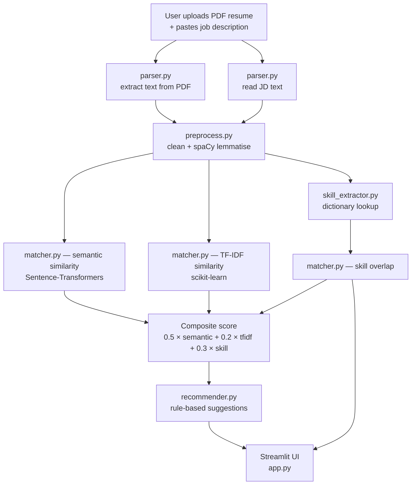
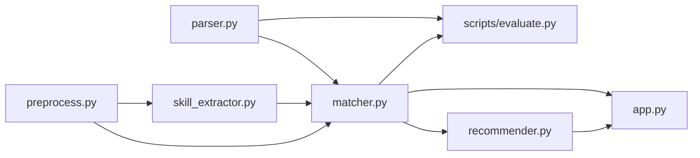

# Architecture

A short tour of how the matcher fits together, with two diagrams.
The first shows the data flow at runtime; the second shows the
file-level dependencies between modules.

## Runtime workflow

## Module dependency graph

## Why each piece exists

- **parser.py** — input layer. Hides the difference between PDF and text resumes.
- **preprocess.py** — text normalisation. Two cleaning levels: light (for embeddings) and heavy (lemmatised, for TF-IDF and keyword matching).
- **skill_extractor.py** — dictionary-based skill spotter. Transparent and explainable, at the cost of being limited to known terms.
- **matcher.py** — the scoring engine. Three independent signals (semantic, TF-IDF, skill) combined with hand-set weights.
- **recommender.py** — turns the match result into rule-based suggestions. No generation, no LLM.
- **app.py** — Streamlit UI on top of the engine.
- **scripts/evaluate.py** — the experiment: compares the three signals against labelled pairs, produces the comparison table.
